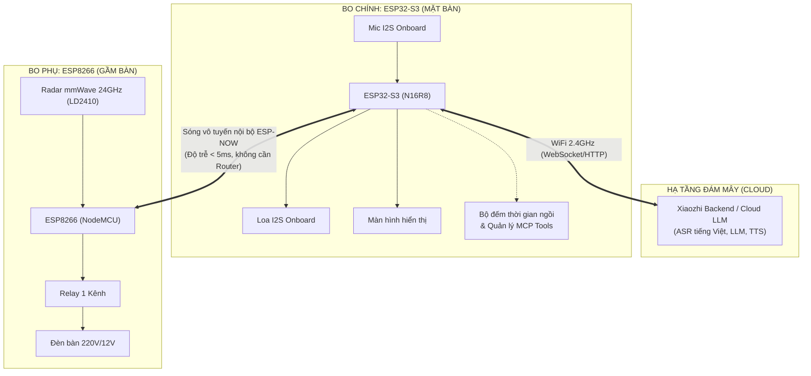

# PHƯƠNG ÁN KỸ THUẬT CHI TIẾT
## DỰ ÁN: TRỢ LÝ BÀN LÀM VIỆC THÔNG MINH (SMART DESK ASSISTANT)

- **Mã dự án**: `DESK-AI-S3`
- **Mục tiêu**: Báo cáo bài tập lớn / Đồ án môn học IoT - Trình diễn tương tác thông minh không chạm (Zero-Touch) và Trợ lý AI giọng nói.
- **Ngày lập**: 26/09/2026

---

## 1. TỔNG QUAN DỰ ÁN

### 1.1. Khái niệm & Mục tiêu
Dự án nhằm biến không gian làm việc cá nhân thành một môi trường **thông minh, tự động hóa hoàn toàn không chạm (Zero-Touch Workspace)** và có khả năng tương tác tự nhiên thông qua **Trợ lý AI đàm thoại tiếng Việt**.

### 1.2. Các tính năng cốt lõi (Core Features)
1. **Chiếu sáng tự động thông minh (Zero-touch Lighting)**:
   - Ứng dụng cảm biến radar sóng milimet 24GHz (LD2410) phát hiện vi chuyển động và nhịp thở của người ngồi vào bàn.
   - Tự động bật đèn bàn khi ngồi vào, tự động tắt đèn sau một khoảng thời gian chờ (timeout) khi rời bàn.
2. **Điều khiển giọng nói qua AI (Voice Assistant via ESP32-S3)**:
   - Ra lệnh bật/tắt đèn bàn bằng ngôn ngữ tự nhiên tiếng Việt qua mô hình AI (Xiaozhi).
   - Tích hợp chuẩn giao tiếp công cụ **MCP (Model Context Protocol)** để AI hiểu và thực thi lệnh phần cứng.
3. **Theo dõi sức khỏe & Công thái học (Desk Ergonomics & Sitting Tracker)**:
   - Tự động đếm thời gian ngồi làm việc liên tục dựa trên dữ liệu thời gian thực từ cảm biến radar.
   - Nhắc nhở bằng giọng nói khi người dùng ngồi quá lâu (ví dụ: > 45 phút).
   - Trả lời bằng giọng nói khi người dùng hỏi: *"Hôm nay tôi đã ngồi làm việc bao lâu rồi?"*.
4. **Giải trí & Tiện ích**:
   - Báo thức, nghe đài phát thanh (VOV), nghe nhạc trực tuyến, thông tin thời tiết qua loa tích hợp trên bo mạch.

### 1.3. Các thành phần đã tối ưu / loại bỏ
- **Bỏ cảm biến quang trở (LDR)**: Tránh lỗi vòng lặp phản xạ ánh sáng (đèn sáng chiếu vào cảm biến khiến đèn tự tắt) và giảm bớt dây nối. Thay thế bằng logic điều kiện thời gian thực (NTP clock).
- **Bỏ phím cảm ứng chạm mặt bàn (TTP223)**: Giữ trọn vẹn triết lý "Zero-touch" (Không chạm), loại bỏ tối đa dây nối bên ngoài để bàn demo gọn gàng, tránh chập chờn tiếp xúc khi chấm điểm.
- **Bỏ điều khiển quạt & quét BLE**: Giảm tải kiến trúc, tập trung vào trải nghiệm mượt mà của hệ thống chiếu sáng và giọng nói AI.

---

## 2. KIẾN TRÚC HỆ THỐNG (SYSTEM ARCHITECTURE)

Hệ thống được thiết kế theo mô hình **Điện toán phân tán Master - Satellite (Chính - Phụ)** kết hợp mạng nội bộ không dây **ESP-NOW** và mạng đám mây **WiFi Internet**:



---

## 3. THIẾT KẾ PHẦN CỨNG & KẾT NỐI (HARDWARE SPECIFICATION)

### 3.1. Danh mục linh kiện

| Thiết bị | Vai trò | Vị trí đặt | Thông số chính |
| :--- | :--- | :--- | :--- |
| **ESP32-S3 (Bo tím)** | Bo điều khiển trung tâm (Master) | Trên mặt bàn | Dual Core 240MHz, 16MB Flash, 8MB PSRAM, Mic + Loa I2S onboard |
| **NodeMCU ESP8266** | Bo điều khiển ngoại vi (Slave) | Dưới gầm bàn | 80MHz, WiFi 2.4GHz, tích hợp giao thức ESP-NOW |
| **HLK-LD2410** | Cảm biến radar hiện diện mmWave | Hướng vào vị trí ghế ngồi | Tần số 24GHz, phát hiện người tĩnh/động, cự ly 0.5m - 5m |
| **Module Relay 2 kênh** | Đóng ngắt đèn | Trong hộp kỹ thuật gầm bàn | Tải 10A/250VAC, cách ly quang (Dùng kênh 1, kênh 2 dự phòng) |
| **Màn hình LCD (Dự kiến)** | Hiển thị thời gian & trạng thái | Gắn cùng bo S3 | ST7789 (240x240) hoặc GC9A01 (tròn 240x240) qua SPI |

### 3.2. Sơ đồ đấu nối bo phụ ESP8266

| Chân Module | Chân nối ESP8266 | Giải thích kỹ thuật |
| :--- | :--- | :--- |
| **LD2410 - VCC** | **VIN (hoặc VU)** | Cấp nguồn 5V ổn định cho module radar |
| **LD2410 - GND** | **GND** | Nối mass chung |
| **LD2410 - OUT** | **D2 (GPIO4)** | Tín hiệu logic: `HIGH` = Có người, `LOW` = Trống |
| **Relay - DC+** | **VIN (5V)** | Cực dương cấp nguồn cuộn hút relay (tương đương VCC) |
| **Relay - DC-** | **GND** | Cực âm nối mass chung (tương đương GND) |
| **Relay - IN1** | **D1 (GPIO5)** | Tín hiệu kích Kênh 1 đóng/ngắt đèn (Mức `LOW` kích đóng tiếp điểm) |
| **Relay - IN2** | *(Bỏ trống)* | Kênh 2 không sử dụng |

---

## 4. GIAO THỨC TRUYỀN THÔNG ESP-NOW (DATA PROTOCOL)

Nhằm tối ưu tốc độ và tránh overhead, 2 bo trao đổi qua cấu trúc dữ liệu nhị phân (Packed Struct) cố định:

### 4.1. Gói tin lệnh: ESP32-S3 ➔ ESP8266 (`DeskCommandPacket`)
Gửi khi Trợ lý AI nhận được lệnh giọng nói từ người dùng.
- **Kích thước**: 2 bytes.

```cpp
struct __attribute__((packed)) DeskCommandPacket {
    uint8_t magic; // Mã nhận diện: 0x5A
    uint8_t cmd;   // 0: Tắt đèn, 1: Bật đèn, 2: Trả lại chế độ tự động
};
```

### 4.2. Gói tin trạng thái: ESP8266 ➔ ESP32-S3 (`DeskStatusPacket`)
Gửi định kỳ 1 giây/lần hoặc gửi ngay khi có thay đổi trạng thái người ngồi.
- **Kích thước**: 7 bytes.

```cpp
struct __attribute__((packed)) DeskStatusPacket {
    uint8_t  magic;             // Mã nhận diện: 0xA5
    uint8_t  is_sitting;        // 1: Đang ngồi tại bàn, 0: Đã rời bàn
    uint8_t  lamp_state;        // 1: Đèn đang sáng, 0: Đèn đang tắt
    uint32_t sitting_time_sec; // Thời gian ngồi liên tục (tính bằng giây)
};
```

### 4.3. Cơ chế đồng bộ kênh truyền (WiFi Channel Synchronization)
- **Vấn đề**: ESP32-S3 khi kết nối WiFi Internet với Router sẽ chạy trên kênh (Channel) do Router chỉ định. Nếu ESP8266 chạy lệch kênh thì ESP-NOW sẽ không bắt được gói tin.
- **Giải pháp kỹ thuật**: 
  - Khởi tạo ESP8266 kết nối thử hoặc quét cùng SSID WiFi của phòng để tự động nhảy về đúng WiFi Channel của Router.
  - Sau khi cùng kênh, gói tin ESP-NOW truyền nhận tức thì với độ trễ < 5ms.

---

## 5. THIẾT KẾ PHẦN MỀM (SOFTWARE DESIGN)

### 5.1. Bo phụ ESP8266 (Firmware Arduino C++)
1. **Bộ lọc chống chập chờn (Hysteresis & Debounce)**:
   - Khi radar phát hiện người: Bật relay đèn ngay lập tức (< 100ms).
   - Khi radar không thấy người: Bắt đầu đếm ngược thời gian chờ `AUTO_OFF_TIMEOUT_SEC` (đặt 30s khi demo, 180s trong thực tế). Nếu người dùng chỉ tạm cúi xuống nhặt đồ hoặc quay người thì đèn vẫn giữ nguyên trạng thái.
2. **Quyền ưu tiên điều khiển (Override Logic)**:
   - Khi nhận lệnh giọng nói từ S3: Kích hoạt cờ `manualOverride = true` để tuân thủ lệnh người dùng.
   - Khi người dùng rời bàn hẳn (hết timeout): Tự động xóa cờ override để trở về trạng thái tự động cho lần ngồi kế tiếp.

### 5.2. Bo chính ESP32-S3 (Mã nguồn C++ / ESP-IDF)
1. **Tích hợp MCP Tools (Model Context Protocol)**:
   - `self.lamp.turn_on`: Bắn gói `cmd = 1` qua ESP-NOW.
   - `self.lamp.turn_off`: Bắn gói `cmd = 0` qua ESP-NOW.
   - `self.lamp.get_state`: Trả về trạng thái thực tế từ `DeskStatusPacket`.
   - `self.desk.get_sitting_time`: Đọc `sitting_time_sec`, chuyển đổi sang phút/giờ để AI sinh câu thoại trả lời: *"Bạn đã ngồi làm việc được X phút rồi"*.
2. **Hệ thống cảnh báo công thái học (Ergonomics Alert Task)**:
   - Một tiến trình nền (FreeRTOS Task) kiểm tra `sitting_time_sec`.
   - Nếu `sitting_time_sec >= 2700` (45 phút) và chưa cảnh báo:
     - Gọi `Application::GetInstance().PlaySound(...)` hoặc phát âm thanh nhắc nhở đứng dậy vươn vai, uống nước.

---

## 6. KỊCH BẢN TRÌNH DIỄN BÁO CÁO (LIVE DEMO WORKFLOW)

| Phút | Hành động thực hiện | Phản ứng của hệ thống | Điểm nhấn công nghệ báo cáo |
| :--- | :--- | :--- | :--- |
| **00:00** | Giới thiệu tổng quan hệ thống phân tán 2 vi điều khiển. | Cả 2 bo khởi động, kết nối ESP-NOW, đèn đang tắt. | Kiến trúc Master-Slave không dây độ trễ thấp. |
| **00:30** | Người thuyết trình bước tới ngồi vào ghế làm việc. | Radar bắt được nhịp thở/chuyển động ➔ Đèn bàn lập tức sáng. S3 bắt đầu đếm giờ. | Cảm biến radar mmWave 24GHz (phân biệt với PIR hồng ngoại giá rẻ). |
| **01:00** | Thuyết trình viên nói: *"Trợ lý ơi, tắt đèn bàn giúp tôi"* | ESP32-S3 phản hồi: *"Đã tắt đèn bàn"* ➔ Đèn bàn tắt ngay lập tức. | Giao thức MCP điều khiển phần cứng bằng LLM đám mây. |
| **01:30** | Thuyết trình viên hỏi: *"Hôm nay tôi đã ngồi làm việc bao lâu rồi?"* | ESP32-S3 trả lời chính xác số phút đã ngồi dựa trên số liệu từ ESP8266. | Khả năng đồng bộ telemetry thời gian thực giữa 2 vi điều khiển. |
| **02:00** | Kích hoạt kịch bản giả lập ngồi quá thời gian (test timeout 1 phút). | Trợ lý tự động cất tiếng nhắc nhở đứng dậy vận động và uống nước. | Ứng dụng IoT vào sức khỏe và công thái học văn phòng. |
| **02:30** | Thuyết trình viên đứng dậy rời khỏi bàn. | Sau 15-30 giây radar xác nhận vắng người ➔ Đèn tự động tắt. | Tự động hóa hoàn toàn không chạm (Zero-Touch). |

---

## 7. KẾ HOẠCH TRIỂN KHAI & KIỂM THỬ (TEST PLAN)

### 7.1. Ma trận kiểm thử (Test Matrix)

| Mã test | Nội dung kiểm tra | Tiêu chuẩn đạt (Pass Criteria) |
| :--- | :--- | :--- |
| **TC-01** | Đọc tín hiệu LD2410 trên ESP8266 | Có người: chân D2 lên `HIGH`, rời bàn: xuống `LOW` chính xác. |
| **TC-02** | Đóng ngắt Relay | Chân D1 xuất mức kích: Relay nhảy tiếng "tách", đèn sáng/tắt chuẩn. |
| **TC-03** | Khung truyền ESP-NOW nội bộ | ESP8266 gửi gói tin, ESP32-S3 nhận đủ 7 bytes với magic `0xA5`. |
| **TC-04** | Đồng bộ kênh khi có WiFi | ESP32-S3 vào WiFi nhà, ESP-NOW vẫn truyền nhận thông suốt, không rớt gói. |
| **TC-05** | Tool Call MCP Voice | Ra lệnh giọng nói tiếng Việt -> MCP gọi đúng hàm kích hoạt ESP-NOW. |
| **TC-06** | Bộ đếm thời gian ngồi | Thời gian tăng tuyến tính khi có người, reset hoặc dừng khi rời bàn. |

### 7.2. Lộ trình thực hiện
1. **Giai đoạn 1**: Nạp code cho ESP8266, test độc lập TC-01 và TC-02 trên mạch thật.
2. **Giai đoạn 2**: Viết module ESP-NOW cho ESP32-S3 trong `xiaozhi-esp32-main`, test TC-03 và TC-04.
3. **Giai đoạn 3**: Tích hợp công cụ MCP vào S3 và test TC-05, TC-06.
4. **Giai đoạn 4**: Ghép nối hoàn chỉnh, tinh chỉnh khoảng cách radar và diễn tập kịch bản demo.
